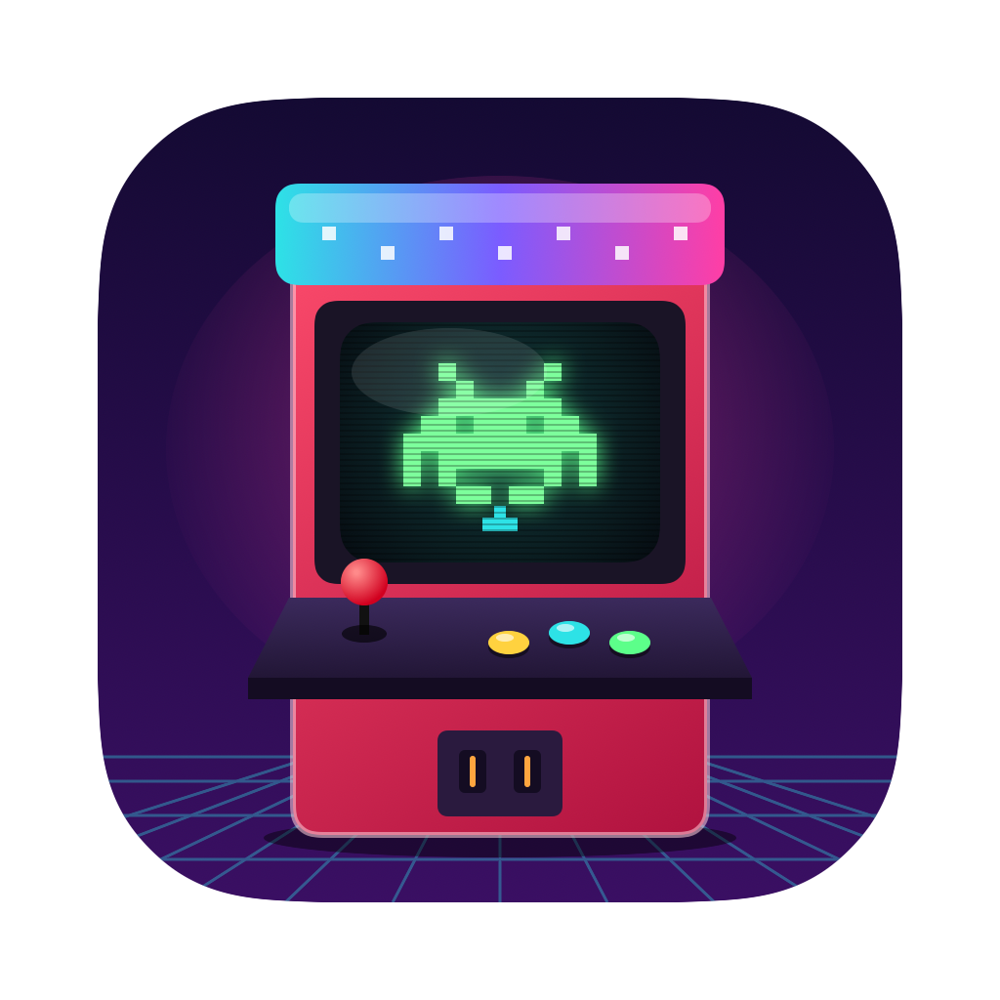
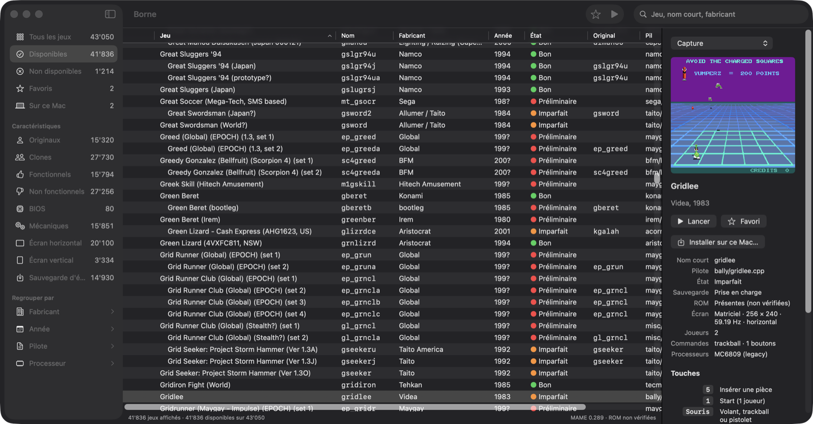

<p align="center"></p>

# Borne

**A native macOS front end for [MAME](https://www.mamedev.org), in the spirit of MAMEUI.**

Borne (French for *arcade cabinet*) puts your MAME collection in a familiar three-pane window:
folders on the left, the list of games in the middle, the artwork and details on the right.
Double-click a game and play.



*Site (French): [borne.pasahome.org](https://borne.pasahome.org)*

## Features

- **MAMEUI-style folders**: available, favorites, parents and clones, working, vertical screens,
  manufacturer, year, driver, CPU…
- **Fast with the full catalogue**: 43 000+ machines, filtering and sorting never freeze the window.
- **Games on an external drive, read-only**: Borne never writes there. Settings, save states,
  NVRAM, high scores and snapshots go to `~/Library/Application Support/Borne/MAME`.
- **Install on this Mac**: copy a game (or all favorites) with its parent, BIOS, devices and
  samples, so it runs without the external drive. Local copies always come first.
- **ROM audit** in the background (`-verifyroms`), interruptible, results shown as they come.
- **Mac keyboard layout**: player 1 buttons on `Z X C V B N` instead of `Ctrl`
  (macOS keeps `Ctrl`+arrows for Mission Control), and a key reminder when a game starts.
- **MAME included**: version 0.289, native Apple silicon build, nothing else to install.

## Download

Get the latest signed and notarized build from the
[Releases](https://github.com/gpasa/borne/releases/latest) page.
Requires macOS 14 or later on Apple silicon.

Borne does **not** include any ROMs. Use only games you are entitled to.

## Build from source

Requirements: Xcode, [XcodeGen](https://github.com/yonaskolb/XcodeGen), the
[SDL3](https://github.com/libsdl-org/SDL/releases) framework in `/Library/Frameworks`.

```bash
# MAME, next to this repository
git clone --depth 1 --branch mame0289 https://github.com/mamedev/mame.git ../MAME
make -C ../MAME -j$(sysctl -n hw.ncpu)

# Borne, with MAME bundled, installed in ~/Applications
scripts/deploy.sh
```

`scripts/release.sh` signs with a Developer ID, notarizes and zips the app.

## License

Borne is free software under the **GNU General Public License v3.0** (`LICENSE`).
Contributions follow the DCO (`CONTRIBUTING.md`).

The app bundles third-party software under their own licenses, included in
`Borne.app/Contents/Resources/Licenses`:

- **MAME** 0.289, © MAMEdev and contributors, GPL-2.0-or-later (with parts under BSD-3-Clause
  and other compatible licenses). The bundled binary is built, unmodified, from the
  [`mame0289` tag](https://github.com/mamedev/mame/tree/mame0289); the commands above rebuild it.
- **SDL3** 3.2.28, zlib license.

MAME is a registered trademark of Gregory Ember. Borne is an independent project, not
affiliated with or endorsed by the MAME team.
